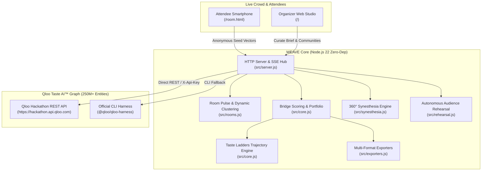

# WEAVE · The Collective Cultural Architect & Synesthetic Resonance Engine

> *"Don't optimize for an isolated user. Design the connections between them."*

WEAVE is an agentic cultural intelligence engine built for the **Qloo Agentic Hackathon 2026** ($25,000 Prize Pool). Powered by Qloo’s Taste AI™ Graph of 250M+ entities, WEAVE solves one of the fundamental failures of modern AI: **recommender systems optimize for the isolated user ($N=1$), but human culture is created collectively ($N > 1$).**

When diverse groups gather—at campus festivals, creative summits, multi-disciplinary conferences, or brand experiences—traditional programming alienates audiences with disjoint tastes or reduces experiences to lowest-common-denominator consensus. WEAVE mines the deep latent manifolds of Qloo’s taste graph to discover unexpected cultural bridges, generate 3-step stepping-stone trajectories, harmonize cross-domain sensory experiences (sound, visual, gastronomy), and stress-test the run-of-show with simulated audience personas before a single dollar is spent.

---

## ⚡ Key Highlights & Hackathon Gate Verification

- **Live Qloo Hackathon API Verified (Gate A Passed):** Connected to `https://hackathon.api.qloo.com` via direct REST transport and official `@qloo/qloo-harness`.
- **Zero-Dependency Architecture:** Pure Node.js v22 standard library (`node:http`, `node:crypto`, `node:fs`). Zero runtime npm dependencies.
- **100% Offline Test Double + Live Dual-Mode:** 27 automated tests passing in ~1.0s (`npm test`). Offline synthetic demo fixtures allow instant exploration without burning API quota.
- **Strict Key Hygiene & Zero Leakage:** Server-side proxy guarantees the Qloo API key is never exposed to browser bundles, never logged, and never included in client exports.

---

## 🏛️ System Architecture



---

## 🚀 5 Breakthrough Innovations

### 1. Cultural Bridge Engine & Multi-Affinity Triage
Unlike single-community recommenders, WEAVE takes 2 to 4 distinct audience profiles and performs simultaneous affinity cross-referencing. Candidates that appear across multiple communities are scored using WEAVE's triage formula:

$$\text{bridgeScore} = 0.70 \times \text{coverageRatio} + 0.30 \times \overline{\text{rankQuality}}$$

where:
- $\text{coverageRatio} = \frac{\text{communitiesCovered}}{\text{totalCommunities}}$
- $\text{rankQuality}(r) = \frac{1}{\sqrt{r}}$ (prioritizing high-tier affinity ranks while rewarding broad cross-cultural relevance)

### 2. Taste Ladders (3-Rung Stepping-Stone Trajectories)
Sudden jumps between alien genres cause cultural whiplash. WEAVE automatically computes **Taste Ladders**: 3-step cultural stepping-stone journeys:
- **Rung 1 (Anchor A):** Community A's familiar cultural home (e.g., Radiohead).
- **Rung 2 (Stepping Stone):** An intermediate entity sharing latent tags across both taste spheres (e.g., Massive Attack sharing *Atmospheric*, *Experimental*, and *Downtempo*).
- **Rung 3 (Anchor B):** Community B's destination (e.g., Hans Zimmer).

### 3. 360° Synesthetic Triad (Cross-Domain Blueprint)
Culture is not just sound. Human memory is multi-sensory. WEAVE queries Qloo across multiple entity domains using the same confirmed community seeds:
- **🎵 Sonic Architecture (`urn:entity:artist`):** Primary musical acts and performers.
- **🎬 Cinematic & Visuals (`urn:entity:movie`):** Stage projections, lighting aesthetics, and mood boards.
- **🍸 Culinary & Brand Activation (`urn:entity:brand`):** Gastronomy pop-ups, cocktail pairings, and sponsor activations.

### 4. Autonomous Audience Rehearsal & Cultural Waste Arbitrage
Before committing financial budgets, organizers can run an agentic rehearsal simulation:
- **Synthetic Personas:** Communities are converted into autonomous personas carrying empirical tag weights extracted from Qloo results.
- **Minute-by-Minute Flow Curve:** Evaluates each segment using the harmonic mean of persona resonance:
  $$H = \frac{n}{\sum_{i=1}^n \frac{1}{x_i}}$$
- **Friction Zone Detection:** Flags segments where taste disparities exceed 45%, suggesting corrective stepping-stones.
- **Commercial Arbitrage (ROI):** Quantifies **Cultural Misallocation Avoided**—demonstrating real financial savings by preventing single-interest acts that alienate the broader room.

### 5. Real-Time Room Pulse (Crowd Telepathy via SSE)
At live events or during judging, attendees open `/room.html` on their smartphones and anonymously submit 2 favorite cultural influences. WEAVE:
- Dynamically clusters the room's tastes into emergent micro-communities.
- Streams live SSE events (`attendee-joined`, `pulse-updated`) back to the organizer console.
- Recalculates collective bridges in real time as the crowd fills the room.

### 6. Agentic Prompt Synthesizer & Intelligent Tradeoff Repair
Organizers often arrive with informal, unstructured intent. WEAVE features an autonomous natural-language agent pipeline:
- **Brief Synthesizer (`/api/agent/brief`):** Ingests raw festival prompts (e.g. *"2-hour festival in Bengaluru for 300 students bridging anime gaming and indie folk with ₹30,000 budget"*), extracts duration, budget, capacity, and maps contrasting audience profiles.
- **Autonomous Tradeoff Solver (`/api/agent/repair`):** When budget or time overruns occur, rather than simply discarding acts, the agent automatically rebalances segment timing and scales production tiers to lean operational models.
- **Printable Production Call-Sheet (`🖨️`):** One-click printable production run-of-show formatted specifically for backstage stage managers and AV technicians.

---

## 📦 Getting Started

### Prerequisites
- Node.js **22.19.0** or newer (built and tested on Node v22).
- Zero external runtime dependencies.

### Installation & Test Suite

```bash
git clone https://github.com/shankarsai000/weave-cultural-bridge.git
cd weave-cultural-bridge
npm test
```
*Executes all 29 automated tests (core, live double, UI, innovations, agentic parser & repair) in under 1 second.*

### Running the Live Qloo Smoke Test

```bash
npm run smoke
```
*Validates live connectivity, artist search, cross-domain insights, tag exploration, and error handling against `https://hackathon.api.qloo.com`.*

### Starting the Server

```bash
# Demo Mode (offline fixtures)
npm start

# Live Qloo Mode (with your event credential)
node --env-file=.env src/server.js
```
Open **[http://localhost:3000](http://localhost:3000)** in your browser.

---

## 🐳 Docker Deployment

WEAVE is fully containerized and production-ready:

```bash
# Rebuild the standalone client bundle
npm run build:web

# Build Docker image
docker build -t weave .

# Run container (credential passed strictly at runtime)
docker run -p 3000:3000 -e QLOO_API_KEY=your-event-key weave
```

---

## 📡 API Reference

| Method | Endpoint | Description |
|---|---|---|
| `GET` | `/api/health` | Service health, version, transport, and credential status (never reveals key). |
| `GET` | `/api/entities/search?q=&type=&mode=` | Search Qloo entities for seed confirmation. |
| `GET` | `/api/tags/search?q=` | Search latent tags across `/v2/tags`. |
| `POST` | `/api/analysis` | Multi-community affinity exploration, bridge triage, and taste ladders. |
| `POST` | `/api/plans` | Compile selected bridge candidates into a timed, budget-checked run-of-show. |
| `PATCH` | `/api/plans/:id` | Edit segment durations, costs, or request automated constraint repair. |
| `POST` | `/api/export` | Export plan as formatted Markdown, CSV, or structured JSON. |
| `POST` | `/api/synesthesia` | Generate 360° cross-domain sensory triad (Sonic + Visual + Brand). |
| `POST` | `/api/rehearse` | Run autonomous agent rehearsal, resonance curve, and ROI simulation. |
| `POST` | `/api/rooms` | Create an active real-time room for live attendee pulse. |
| `GET` | `/api/rooms/:id/stream` | Server-Sent Events (SSE) feed for live crowd telepathy. |
| `POST` | `/api/rooms/:id/join` | Mobile endpoint for attendees to submit anonymous seed vectors. |
| `POST` | `/api/rooms/:id/simulate` | Instantly inject 3 diverse attendee personas to test dynamic clustering. |

---

## 🔒 Security, Provenance & Ethical AI

- **Zero Credential Exposure:** All Qloo queries occur strictly server-side. The API key is never rendered in HTML, sent over SSE, or included in export files.
- **Explicit Provenance Labels:** Every entity, tag, and plan item is strictly labeled with its provenance:
  - `qloo-live`: Verified live responses from Qloo Taste AI™.
  - `demo-fixture`: Labelled synthetic fixtures for zero-quota testing.
- **Objective Mathematical Triage:** WEAVE never claims proprietary attendance prediction or black-box certainty. Bridge scores are clearly presented as rank-based triage heuristics to assist human curators.

---

## 📄 License

MIT License. Designed and engineered for the **Qloo Agentic Hackathon 2026**.
